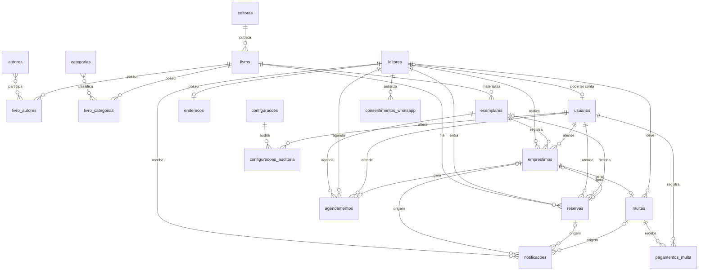

# Modelo relacional da biblioteca comunitária — Etapa 2 (Função 2, azul)

## Objetivo e compatibilidade

Este documento propõe o DER relacional compatível com a base criada na Etapa 1: o projeto já possui SQLite com `better-sqlite3` como dependência prevista, `CONTEXTO.md` com as regras de negócio e um pacote `shared/` ainda vazio. **Nenhuma tabela, migration ou conexão é criada nesta etapa**: o modelo abaixo é a especificação que orientará a Etapa 3 (tipos) e a Etapa 7 (migrations).

Convenções adotadas:

- `INTEGER`, `TEXT` e `BLOB` são os tipos SQLite usados. Chaves surrogate são `INTEGER PRIMARY KEY AUTOINCREMENT`.
- Datas usam `TEXT` no formato `YYYY-MM-DD`; instantes usam `TEXT` ISO-8601 em UTC (`YYYY-MM-DDTHH:MM:SSZ`). O fuso funcional da biblioteca (`America/Sao_Paulo`) fica em configuração.
- Valores monetários são `INTEGER` em centavos, nunca ponto flutuante.
- `deleted_at` significa exclusão lógica. Tabelas históricas não usam `DELETE`: apenas troca de `status`/arquivamento.
- `ON DELETE RESTRICT` protege qualquer registro referenciado por histórico. `CASCADE` só aparece nas tabelas de associação N:N.

## Diagrama Mermaid

## Cardinalidades (resumo)

| Relação | Cardinalidade | Leitura |
| --- | --- | --- |
| editora → livro | 1:N (0..N) | uma editora publica vários livros; um livro pode não ter editora informada |
| livro ↔ autor | N:N | vários autores por livro e vários livros por autor, via `livro_autores` |
| livro ↔ categoria | N:N | mesma lógica, via `livro_categorias` |
| livro → exemplar | 1:N | um livro bibliográfico tem vários exemplares físicos; cada exemplar pertence a um livro |
| leitor → endereço | 1:0..1 | endereço opcional e único por leitor |
| leitor → usuário | 0..1:0..1 | leitor pode ter conta; ADMIN/ATENDENTE normalmente não têm leitor associado |
| leitor/exemplar → empréstimo | 1:N | histórico completo de quem retirou qual exemplar |
| livro → reserva (fila) | 1:N | vários leitores na fila do mesmo livro |
| exemplar → agendamento | 1:N | um exemplar disponível pode ser agendado em dias diferentes |
| empréstimo → multa | 1:0..1 | no máximo uma multa definitiva por empréstimo atrasado |
| multa → pagamento | 1:N | pagamentos parciais e estornos são registrados sem apagar a multa |
| configuração → auditoria | 1:N | toda alteração gera registro com autor e data |
| leitor → notificação | 1:N | histórico de avisos; a origem pode ser empréstimo, reserva ou multa |

## Dicionário de dados

### `editoras` — catálogo

| Coluna | Tipo | Obrig. | Restrições | Observação |
| --- | --- | --- | --- | --- |
| `id` | INTEGER | sim | PK, AUTOINCREMENT | chave interna |
| `nome` | TEXT | sim | CHECK `length(trim(nome)) > 0` | nome da editora |
| `deleted_at` | TEXT | não | exclusão lógica | nulo = ativa |

**UNIQUE:** parcial em `nome` quando `deleted_at IS NULL`. **Índices:** `idx_editoras_nome (nome)`.

### `autores` — catálogo

| Coluna | Tipo | Obrig. | Restrições | Observação |
| --- | --- | --- | --- | --- |
| `id` | INTEGER | sim | PK, AUTOINCREMENT | chave interna |
| `nome` | TEXT | sim | CHECK `length(trim(nome)) > 0` | nome civil/artístico |
| `deleted_at` | TEXT | não | exclusão lógica | nulo = ativo |

**UNIQUE:** parcial em `nome` quando `deleted_at IS NULL`. **Índices:** `idx_autores_nome (nome)`.

### `categorias` — catálogo

| Coluna | Tipo | Obrig. | Restrições | Observação |
| --- | --- | --- | --- | --- |
| `id` | INTEGER | sim | PK, AUTOINCREMENT | chave interna |
| `nome` | TEXT | sim | CHECK `length(trim(nome)) > 0` | ex.: ficção, história |
| `deleted_at` | TEXT | não | exclusão lógica | nulo = ativa |

**UNIQUE:** parcial em `nome` quando `deleted_at IS NULL`. **Índices:** `idx_categorias_nome (nome)`.

### `livros` — registro bibliográfico (não é o exemplar físico)

| Coluna | Tipo | Obrig. | Restrições | Observação |
| --- | --- | --- | --- | --- |
| `id` | INTEGER | sim | PK, AUTOINCREMENT | chave do livro bibliográfico |
| `titulo` | TEXT | sim | CHECK `length(trim(titulo)) > 0` | título principal |
| `subtitulo` | TEXT | não | — | opcional |
| `isbn10` | TEXT | não | CHECK formato de 10 caracteres | digitado ou sugerido |
| `isbn13` | TEXT | não | CHECK formato de 13 caracteres | preferido para busca |
| `editora_id` | INTEGER | não | FK → `editoras(id)` ON DELETE RESTRICT | opcional se desconhecida |
| `ano_publicacao` | INTEGER | não | CHECK `ano_publicacao BETWEEN 0 AND 2100` | ano simples |
| `descricao_curta` | TEXT | não | — | resumo da sugestão/cadastro |
| `capa_url` | TEXT | não | CHECK `capa_url LIKE 'https://%'` | somente HTTPS |
| `idioma` | TEXT | sim | DEFAULT `'pt-BR'` | idioma da obra |
| `criado_em` | TEXT | sim | — | instante UTC |
| `atualizado_em` | TEXT | sim | — | instante UTC |
| `deleted_at` | TEXT | não | exclusão lógica | nulo = ativo |

**UNIQUE:** parcial em `isbn13` e em `isbn10` quando não nulos e `deleted_at IS NULL`. **CHECK:** pelo menos um identificador ou título válido já garantido por `titulo`. **Índices:** `idx_livros_titulo (titulo)`, `idx_livros_editora (editora_id)`, `idx_livros_ano (ano_publicacao)`.

### `livro_autores` — associação N:N

| Coluna | Tipo | Obrig. | Restrições | Observação |
| --- | --- | --- | --- | --- |
| `livro_id` | INTEGER | sim | PK composta, FK → `livros(id)` ON DELETE RESTRICT | livro |
| `autor_id` | INTEGER | sim | PK composta, FK → `autores(id)` ON DELETE RESTRICT | autor |
| `ordem` | INTEGER | sim | DEFAULT 1, CHECK `ordem > 0` | ordem de exibição na ficha |

**PK:** `(livro_id, autor_id)`. **Índices:** `idx_livro_autores_autor (autor_id)`.

### `livro_categorias` — associação N:N

| Coluna | Tipo | Obrig. | Restrições | Observação |
| --- | --- | --- | --- | --- |
| `livro_id` | INTEGER | sim | PK composta, FK → `livros(id)` ON DELETE RESTRICT | livro |
| `categoria_id` | INTEGER | sim | PK composta, FK → `categorias(id)` ON DELETE RESTRICT | categoria |

**PK:** `(livro_id, categoria_id)`. **Índices:** `idx_livro_categorias_categoria (categoria_id)`.

### `exemplares` — exemplar físico (cópia circulating)

| Coluna | Tipo | Obrig. | Restrições | Observação |
| --- | --- | --- | --- | --- |
| `id` | INTEGER | sim | PK, AUTOINCREMENT | chave do exemplar |
| `livro_id` | INTEGER | sim | FK → `livros(id)` ON DELETE RESTRICT | qual obra este exemplar representa |
| `codigo_tombamento` | TEXT | sim | UNIQUE, CHECK `length(trim(codigo_tombamento)) > 0` | código visível no balcão |
| `estado_conservacao` | TEXT | sim | CHECK IN (`'novo'`,`'bom'`,`'regular'`,`'danificado'`) | estado físico |
| `status` | TEXT | sim | CHECK IN (`'disponivel'`,`'emprestado'`,`'reservado'`,`'agendado'`,`'em_manutencao'`,`'inativo'`) | reflexo das operações |
| `localizacao` | TEXT | não | — | prateleira/setor |
| `adquirido_em` | TEXT | não | CHECK `length(adquirido_em) = 10` | data de aquisição |
| `criado_em` | TEXT | sim | — | instante UTC |
| `atualizado_em` | TEXT | sim | — | instante UTC |
| `deleted_at` | TEXT | não | exclusão lógica | nulo = ativo |

**Índices:** `idx_exemplares_livro (livro_id)`, `idx_exemplares_status (status)`, `idx_exemplares_tombamento (codigo_tombamento)` UNIQUE. Observação: `status` é mantido pelas transações de empréstimo/reserva e nunca substitui o histórico.

### `leitores` — pessoas atendidas

| Coluna | Tipo | Obrig. | Restrições | Observação |
| --- | --- | --- | --- | --- |
| `id` | INTEGER | sim | PK, AUTOINCREMENT | chave interna |
| `nome` | TEXT | sim | CHECK `length(trim(nome)) > 0` | nome completo |
| `cpf_cifrado` | BLOB | sim | nunca texto puro | ciframento autenticado (AES-256-GCM ou XChaCha20-Poly1305), nonce aleatório por linha |
| `cpf_hash` | BLOB | sim | UNIQUE, CHECK `length(cpf_hash) = 32` | HMAC-SHA256 com chave separada sobre apenas os dígitos; busca exata |
| `cpf_mascara` | TEXT | sim | CHECK `length(cpf_mascara) BETWEEN 1 AND 20` | única forma de CPF exibida em telas/logs |
| `email` | TEXT | não | CHECK `email LIKE '%@%'` | contato para notificações |
| `telefone` | TEXT | não | CHECK `telefone LIKE '+%'` | formato internacional, quando informado |
| `ativo` | INTEGER | sim | DEFAULT 1, CHECK IN (0,1) | bloqueio de novos empréstimos |
| `criado_em` | TEXT | sim | — | instante UTC |
| `atualizado_em` | TEXT | sim | — | instante UTC |
| `deleted_at` | TEXT | não | exclusão lógica | nulo = ativo |

**Índices:** `uq_leitores_cpf_hash (cpf_hash)` UNIQUE, `idx_leitores_nome (nome)`, `idx_leitores_ativo (ativo, deleted_at)`. Observação: as chaves de cifragem/HMAC vêm de variáveis de ambiente validadas, nunca do repositório. Hash simples de CPF não é usado porque permitiria busca por força bruta.

### `enderecos` — endereço do leitor (ViaCEP)

| Coluna | Tipo | Obrig. | Restrições | Observação |
| --- | --- | --- | --- | --- |
| `id` | INTEGER | sim | PK, AUTOINCREMENT | chave interna |
| `leitor_id` | INTEGER | sim | UNIQUE, FK → `leitores(id)` ON DELETE RESTRICT | um endereço por leitor |
| `cep` | TEXT | sim | CHECK `length(cep) = 8` | oito dígitos, sem máscara |
| `logradouro` | TEXT | sim | CHECK `length(trim(logradouro)) > 0` | rua/avenida |
| `numero` | TEXT | não | — | complementar manual |
| `complemento` | TEXT | não | — | complementar manual |
| `bairro` | TEXT | não | — | bairro |
| `cidade` | TEXT | sim | CHECK `length(trim(cidade)) > 0` | município |
| `uf` | TEXT | sim | CHECK `length(uf) = 2` | sigla do estado |
| `atualizado_em` | TEXT | sim | — | instante UTC |

**Índices:** `uq_enderecos_leitor (leitor_id)` UNIQUE, `idx_enderecos_cep (cep)`.

### `usuarios` — usuários do sistema

| Coluna | Tipo | Obrig. | Restrições | Observação |
| --- | --- | --- | --- | --- |
| `id` | INTEGER | sim | PK, AUTOINCREMENT | chave interna |
| `leitor_id` | INTEGER | não | UNIQUE, FK → `leitores(id)` ON DELETE RESTRICT | obrigatório somente quando `perfil = 'LEITOR'` |
| `nome` | TEXT | sim | CHECK `length(trim(nome)) > 0` | nome de quem usa o sistema |
| `email` | TEXT | sim | CHECK `email LIKE '%@%'` | login |
| `senha_hash` | TEXT | sim | nunca senha em texto | derivação resistente a offline (Argon2id ou bcrypt) |
| `perfil` | TEXT | sim | CHECK IN (`'ADMIN'`,`'ATENDENTE'`,`'LEITOR'`) | papel explícito |
| `ativo` | INTEGER | sim | DEFAULT 1, CHECK IN (0,1) | usuário habilitado |
| `codigo_ativacao_hash` | TEXT | não | código de uso único armazenado protegido | nunca código em texto puro |
| `codigo_ativacao_expira_em` | TEXT | não | — | instante UTC |
| `codigo_ativacao_usado_em` | TEXT | não | — | instante UTC |
| `ultimo_login_em` | TEXT | não | — | instante UTC |
| `criado_em` | TEXT | sim | — | instante UTC |
| `atualizado_em` | TEXT | sim | — | instante UTC |
| `deleted_at` | TEXT | não | exclusão lógica | nulo = ativo |

**CHECK:** `perfil <> 'LEITOR' OR leitor_id IS NOT NULL`; código de ativação expirado/usado não é aceito pela camada de serviço. **UNIQUE:** parcial em `email` quando `deleted_at IS NULL`. **Índices:** `uq_usuarios_email (email)`, `uq_usuarios_leitor (leitor_id)`, `idx_usuarios_perfil (perfil)`.

### `emprestimos` — histórico de empréstimos

| Coluna | Tipo | Obrig. | Restrições | Observação |
| --- | --- | --- | --- | --- |
| `id` | INTEGER | sim | PK, AUTOINCREMENT | chave do empréstimo |
| `exemplar_id` | INTEGER | sim | FK → `exemplares(id)` ON DELETE RESTRICT | exemplar retirado |
| `leitor_id` | INTEGER | sim | FK → `leitores(id)` ON DELETE RESTRICT | responsável |
| `registrado_por_usuario_id` | INTEGER | sim | FK → `usuarios(id)` ON DELETE RESTRICT | quem registrou no balcão |
| `data_emprestimo` | TEXT | sim | CHECK `length(data_emprestimo) = 10` | data da retirada |
| `data_devolucao_prevista` | TEXT | sim | CHECK `length(data_devolucao_prevista) = 10` | prazo inicial/renovado |
| `data_devolucao_real` | TEXT | não | CHECK `length(data_devolucao_real) = 10` | preenchido na devolução |
| `renovacoes` | INTEGER | sim | DEFAULT 0, CHECK `renovacoes BETWEEN 0 AND 1` | no máximo uma renovação |
| `status` | TEXT | sim | CHECK IN (`'aberto'`,`'devolvido'`,`'cancelado'`) | situação do registro |
| `observacao` | TEXT | não | — | texto livre do balcão |
| `criado_em` | TEXT | sim | — | instante UTC |

**CHECK adicional:** `data_devolucao_prevista >= data_emprestimo` e, quando houver devolução, `data_devolucao_real >= data_emprestimo`. **Índices:** `uq_emprestimos_exemplar_aberto (exemplar_id) WHERE status = 'aberto'` (parcial, impede dois empréstimos abertos do mesmo exemplar), `idx_emprestimos_leitor_status (leitor_id, status)`, `idx_emprestimos_prevista (data_devolucao_prevista)`, `idx_emprestimos_status (status)`.

### `reservas` — fila FIFO por livro

| Coluna | Tipo | Obrig. | Restrições | Observação |
| --- | --- | --- | --- | --- |
| `id` | INTEGER | sim | PK, AUTOINCREMENT | ordem desempate da fila |
| `livro_id` | INTEGER | sim | FK → `livros(id)` ON DELETE RESTRICT | livro desejado (sem data escolhida) |
| `leitor_id` | INTEGER | sim | FK → `leitores(id)` ON DELETE RESTRICT | leitor na fila |
| `registrado_por_usuario_id` | INTEGER | sim | FK → `usuarios(id)` ON DELETE RESTRICT | quem registrou |
| `entrada_em` | TEXT | sim | — | instante de entrada; ordena a fila com `id` |
| `status` | TEXT | sim | CHECK IN (`'aguardando'`,`'disponivel_para_retirada'`,`'retirado'`,`'expirado'`,`'cancelado'`) | situação |
| `notificado_em` | TEXT | não | — | instante do aviso |
| `prazo_retirada_inicio` | TEXT | não | — | início das 24 horas |
| `prazo_retirada_fim` | TEXT | não | — | fim já prorrogado para próximo dia útil |
| `exemplar_destinado_id` | INTEGER | não | FK → `exemplares(id)` ON DELETE RESTRICT | exemplar separado para o primeiro da fila |
| `emprestimo_id` | INTEGER | não | FK → `emprestimos(id)` ON DELETE RESTRICT | gerado após a retirada |
| `atualizado_em` | TEXT | sim | — | instante UTC |

**CHECK:** se `status IN ('disponivel_para_retirada','retirado')` então início e fim do prazo devem existir; `prazo_retirada_fim >= prazo_retirada_inicio`. **UNIQUE parcial:** `(leitor_id, livro_id)` quando `status IN ('aguardando','disponivel_para_retirada')` (evita reserva duplicada ativa; limite de 3 por leitor é validado em serviço). **Índices:** `idx_reservas_fila (livro_id, status, entrada_em, id)` (FIFO), `idx_reservas_leitor (leitor_id, status)`, `idx_reservas_prazo (prazo_retirada_fim)`.

### `agendamentos` — agendamento separado de exemplar disponível

| Coluna | Tipo | Obrig. | Restrições | Observação |
| --- | --- | --- | --- | --- |
| `id` | INTEGER | sim | PK, AUTOINCREMENT | chave do agendamento |
| `exemplar_id` | INTEGER | sim | FK → `exemplares(id)` ON DELETE RESTRICT | exemplar já disponível |
| `leitor_id` | INTEGER | sim | FK → `leitores(id)` ON DELETE RESTRICT | leitor |
| `registrado_por_usuario_id` | INTEGER | sim | FK → `usuarios(id)` ON DELETE RESTRICT | quem registrou |
| `data_agendada` | TEXT | sim | CHECK `length(data_agendada) = 10` | dia escolhido (até 3 dias à frente, validado em serviço) |
| `validade_ate` | TEXT | sim | — | fim do dia agendado |
| `status` | TEXT | sim | CHECK IN (`'ativo'`,`'retirado'`,`'expirado'`,`'cancelado'`) | situação |
| `emprestimo_id` | INTEGER | não | FK → `emprestimos(id)` ON DELETE RESTRICT | gerado após a retirada |
| `criado_em` | TEXT | sim | — | instante UTC |
| `atualizado_em` | TEXT | sim | — | instante UTC |

**UNIQUE parcial:** `(leitor_id, exemplar_id, data_agendada)` quando `status = 'ativo'`. **Índices:** `idx_agendamentos_exemplar_data (exemplar_id, data_agendada)`, `idx_agendamentos_leitor (leitor_id, status)`, `idx_agendamentos_validade (validade_ate)`.

### `multas` — multas por atraso (histórico)

| Coluna | Tipo | Obrig. | Restrições | Observação |
| --- | --- | --- | --- | --- |
| `id` | INTEGER | sim | PK, AUTOINCREMENT | chave da multa |
| `emprestimo_id` | INTEGER | sim | UNIQUE, FK → `emprestimos(id)` ON DELETE RESTRICT | uma multa definitiva por empréstimo |
| `leitor_id` | INTEGER | sim | FK → `leitores(id)` ON DELETE RESTRICT | devedor |
| `dias_atraso` | INTEGER | sim | CHECK `dias_atraso > 0` | dias considerados |
| `valor_diario_centavos` | INTEGER | sim | CHECK `valor_diario_centavos >= 0` | política vigente na registragem |
| `teto_centavos` | INTEGER | sim | CHECK `teto_centavos >= 0` | teto vigente na registragem |
| `valor_centavos` | INTEGER | sim | CHECK `valor_centavos >= 0 AND valor_centavos <= teto_centavos` | valor calculado na época |
| `status` | TEXT | sim | CHECK IN (`'pendente'`,`'paga'`,`'perdoada'`,`'estornada'`) | situação |
| `registrada_em` | TEXT | sim | — | instante UTC |
| `perdao_motivo` | TEXT | não | — | obrigatório se perdoada |
| `perdao_por_usuario_id` | INTEGER | não | FK → `usuarios(id)` ON DELETE RESTRICT | ADMIN que perdoou |
| `perdao_em` | TEXT | não | — | instante UTC |

**CHECK:** `status <> 'perdoada' OR (perdao_motivo IS NOT NULL AND perdao_por_usuario_id IS NOT NULL AND perdao_em IS NOT NULL)`. **Índices:** `uq_multas_emprestimo (emprestimo_id)` UNIQUE, `idx_multas_leitor_status (leitor_id, status)`, `idx_multas_registrada (registrada_em)`. Observação: valores da política são copiados na linha, então mudança futura em `configuracoes` não recalcula multas antigas.

### `pagamentos_multa` — pagamentos e estornos

| Coluna | Tipo | Obrig. | Restrições | Observação |
| --- | --- | --- | --- | --- |
| `id` | INTEGER | sim | PK, AUTOINCREMENT | chave do pagamento |
| `multa_id` | INTEGER | sim | FK → `multas(id)` ON DELETE RESTRICT | multa quitada/parcial |
| `valor_centavos` | INTEGER | sim | CHECK `valor_centavos > 0` | valor do lançamento |
| `forma` | TEXT | sim | CHECK IN (`'dinheiro'`,`'pix'`,`'cartao'`,`'outro'`) | forma de pagamento |
| `registrado_por_usuario_id` | INTEGER | sim | FK → `usuarios(id)` ON DELETE RESTRICT | atendente/ADMIN responsável |
| `registrado_em` | TEXT | sim | — | instante UTC |
| `comprovante` | TEXT | não | — | referência interna, sem segredo |

**Índices:** `idx_pagamentos_multa (multa_id)`, `idx_pagamentos_data (registrado_em)`.

### `configuracoes` — políticas configuráveis (linha única)

| Coluna | Tipo | Obrig. | Restrições | Observação |
| --- | --- | --- | --- | --- |
| `id` | INTEGER | sim | PK, CHECK `id = 1` | linha única |
| `prazo_emprestimo_dias` | INTEGER | sim | CHECK `> 0` | 14 (inicial) |
| `limite_exemplares_por_leitor` | INTEGER | sim | CHECK `BETWEEN 1 AND 10` | 3 (inicial) |
| `prazo_renovacao_dias` | INTEGER | sim | CHECK `> 0` | 7 (inicial) |
| `limite_reservas_ativas` | INTEGER | sim | CHECK `BETWEEN 1 AND 10` | 3 (inicial) |
| `prazo_retirada_horas` | INTEGER | sim | CHECK `> 0` | 24 (inicial) |
| `antecedencia_aviso_dias` | INTEGER | sim | CHECK `> 0` | 2 (inicial) |
| `hora_aviso_atraso` | TEXT | sim | CHECK `length(hora_aviso_atraso) = 5` | `'08:00'` (inicial) |
| `valor_diario_multa_centavos` | INTEGER | sim | CHECK `>= 0` | 50 (R$ 0,50) |
| `teto_multa_centavos` | INTEGER | sim | CHECK `>= 0` | 1500 (R$ 15,00) |
| `dias_max_agendamento` | INTEGER | sim | CHECK `> 0` | 3 (inicial) |
| `timezone` | TEXT | sim | CHECK `length(timezone) > 0` | fuso funcional |
| `atualizado_em` | TEXT | sim | — | instante UTC |
| `atualizado_por_usuario_id` | INTEGER | sim | FK → `usuarios(id)` ON DELETE RESTRICT | último ADMIN a alterar |

**Índices:** chave primária `id`; nenhum outro necessário (tabela de uma linha). Os números acima são Defaults documentados, não regras espalhadas no código.

### `configuracoes_auditoria` — histórico de alterações de configuração

| Coluna | Tipo | Obrig. | Restrições | Observação |
| --- | --- | --- | --- | --- |
| `id` | INTEGER | sim | PK, AUTOINCREMENT | chave do evento |
| `configuracao_id` | INTEGER | sim | FK → `configuracoes(id)` ON DELETE RESTRICT | configuração alterada |
| `alterado_por_usuario_id` | INTEGER | sim | FK → `usuarios(id)` ON DELETE RESTRICT | autor (ADMIN) |
| `alterado_em` | TEXT | sim | — | instante UTC |
| `campo` | TEXT | sim | CHECK `length(trim(campo)) > 0` | nome do campo |
| `valor_anterior` | TEXT | não | — | valor serializado antes |
| `valor_novo` | TEXT | não | — | valor serializado depois |

**Índices:** `idx_config_auditoria_data (configuracao_id, alterado_em)`, `idx_config_auditoria_usuario (alterado_por_usuario_id)`.

### `notificacoes` — registro de avisos (e-mail/WhatsApp)

| Coluna | Tipo | Obrig. | Restrições | Observação |
| --- | --- | --- | --- | --- |
| `id` | INTEGER | sim | PK, AUTOINCREMENT | chave da notificação |
| `leitor_id` | INTEGER | sim | FK → `leitores(id)` ON DELETE RESTRICT | destinatário principal |
| `usuario_destinatario_id` | INTEGER | não | FK → `usuarios(id)` ON DELETE RESTRICT | aviso interno, se houver |
| `tipo` | TEXT | sim | CHECK IN (`'ativacao'`,`'lembrete_vencimento'`,`'atraso'`,`'reserva_disponivel'`,`'multa'`,`'expiracao_reserva'`) | evento que disparou |
| `canal` | TEXT | sim | CHECK IN (`'email'`,`'whatsapp'`) | canal usado |
| `status` | TEXT | sim | CHECK IN (`'pendente'`,`'enviada'`,`'falhou'`,`'reenviada'`) | situação da tentativa |
| `chave_idempotencia` | TEXT | sim | UNIQUE | evita duplicar o mesmo evento |
| `destinatario_cifrado` | BLOB | não | ciframento autenticado | endereço/telefone reais protegidos |
| `destinatario_mascara` | TEXT | sim | — | exibição segura na central |
| `emprestimo_id` | INTEGER | não | FK → `emprestimos(id)` ON DELETE RESTRICT | origem |
| `reserva_id` | INTEGER | não | FK → `reservas(id)` ON DELETE RESTRICT | origem |
| `multa_id` | INTEGER | não | FK → `multas(id)` ON DELETE RESTRICT | origem |
| `criado_em` | TEXT | sim | — | instante UTC |
| `enviado_em` | TEXT | não | — | instante UTC |
| `erro_resumo` | TEXT | não | — | mensagem curta, sem token/CPF |
| `tentativas` | INTEGER | sim | DEFAULT 0, CHECK `tentativas >= 0` | contador de envios |

**Índices:** `uq_notificacoes_idempotencia (chave_idempotencia)` UNIQUE, `idx_notificacoes_leitor_data (leitor_id, criado_em)`, `idx_notificacoes_status_data (status, criado_em)`, `idx_notificacoes_tipo_canal (tipo, canal)`.

### `consentimentos_whatsapp` — consentimento revogável

| Coluna | Tipo | Obrig. | Restrições | Observação |
| --- | --- | --- | --- | --- |
| `id` | INTEGER | sim | PK, AUTOINCREMENT | chave do registro |
| `leitor_id` | INTEGER | sim | FK → `leitores(id)` ON DELETE RESTRICT | leitor |
| `telefone_cifrado` | BLOB | sim | ciframento autenticado | telefone em formato internacional |
| `telefone_mascara` | TEXT | sim | — | exibição segura |
| `consentimento` | INTEGER | sim | CHECK IN (0,1) | 1 = autorizado |
| `registrado_em` | TEXT | sim | — | instante UTC |
| `revogado_em` | TEXT | não | — | instante UTC |
| `origem` | TEXT | sim | CHECK IN (`'formulario'`,`'atendente'`,`'importacao'`) | como foi obtido |

**CHECK:** `consentimento = 1 OR revogado_em IS NOT NULL`. **Índices:** `idx_consentimento_leitor (leitor_id, consentimento)`. Nenhum envio é feito sem `consentimento = 1` e `revogado_em IS NULL`.

## Justificativa breve

- **Livro bibliográfico × exemplar físico:** `livros` guarda metadados (ISBN, título, capa); `exemplares` guarda tombamento, estado e disponibilidade. Isso permite várias cópias e evita misturar sugestão externa com posse real.
- **N:N explícitas:** `livro_autores` e `livro_categorias` evitam duplicação de autores/categorias e mantêm ordem de autoria.
- **Histórico preservado:** `emprestimos`, `reservas`, `agendamentos`, `multas`, `pagamentos_multa`, `notificacoes` e auditorias só mudam de `status`; restrições de FK impedem apagar pais referenciados. Empréstimos devolvidos e reservas expiradas continuam consultáveis.
- **CPF protegido:** `cpf_cifrado` com modo autenticado e nonce aleatório impedem leitura; `cpf_hash` com HMAC e chave separada permite busca exata e unicidade sem texto puro; `cpf_mascara` atende telas e logs. Chaves vivem fora do Git.
- **Exclusão lógica:** catálogo, leitores, usuários e endereços usam `deleted_at`; índices `UNIQUE` parciais permitem reaproveitar nome/ISBN de um registro inativado sem apagar o antigo.
- **Dinheiro e datas:** centavos em `INTEGER` eliminam erro de ponto flutuante; a política vigente é copiada para `multas`, garantindo não retroatividade.
- **Concorrência:** o índice parcial de empréstimo aberto por exemplar e as UNIQUE parciais de reserva/agendamento são a barreira de banco que complementa as transações da Etapa 20.
- **Configuração:** linha única com Defaults documentados e auditoria; nenhuma regra de prazo/multa fica hardcoded na lógica.

## Conferência

- [x] 19 tabelas, todas com PK definida e pelo menos uma FK real (inclusive `configuracoes`, que referencia `usuarios`).
- [x] Todas as tabelas de domínio estão conectadas no diagrama: catálogo → livros → exemplares → operações → pessoas → notificações/configuração.
- [x] N:N livro/autor e livro/categoria presentes; livro bibliográfico distinto de exemplar físico.
- [x] Histórico de empréstimos e reservas preservado por `status` e `ON DELETE RESTRICT`.
- [x] CPF nunca em texto puro; busca exata por HMAC; máscara para exibição.
- [x] CRUD futuro por entidade: criar, ler, atualizar e "excluir" como inativação (`deleted_at`) em catálogo/pessoas; em tabelas históricas, exclusão é substituída por cancelamento/expiração/perdão com auditoria. Nenhuma operação exige apagar histórico.
- [x] Nenhuma migration ou criação de tabela foi escrita nesta etapa.
